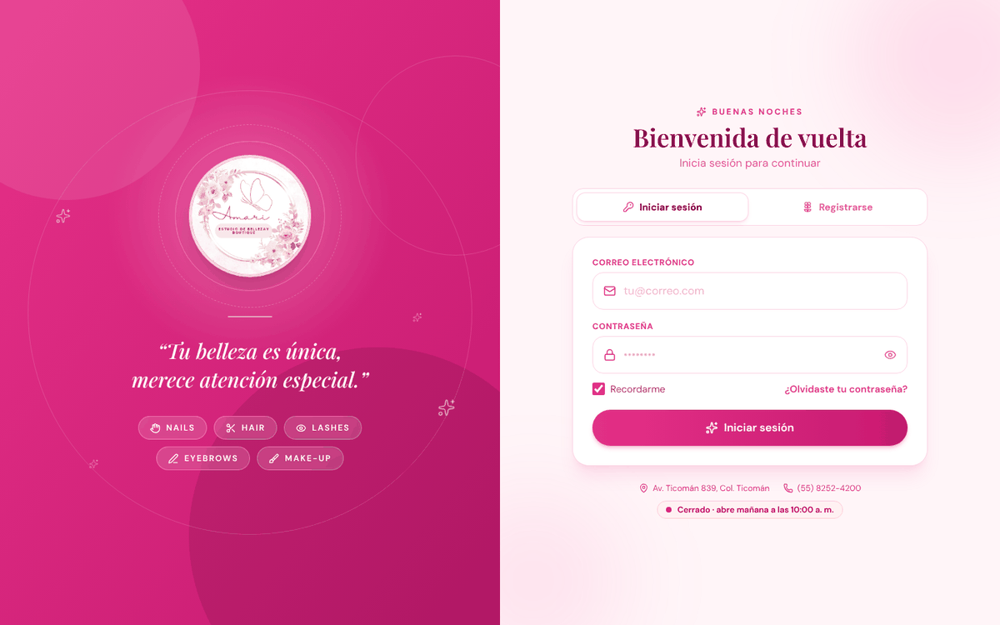
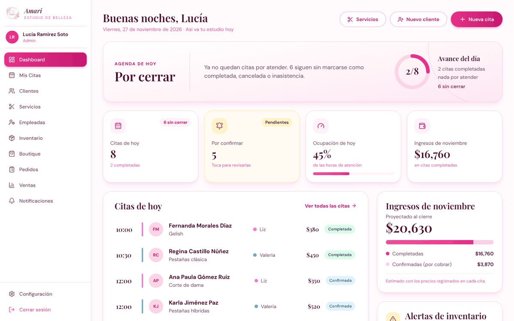
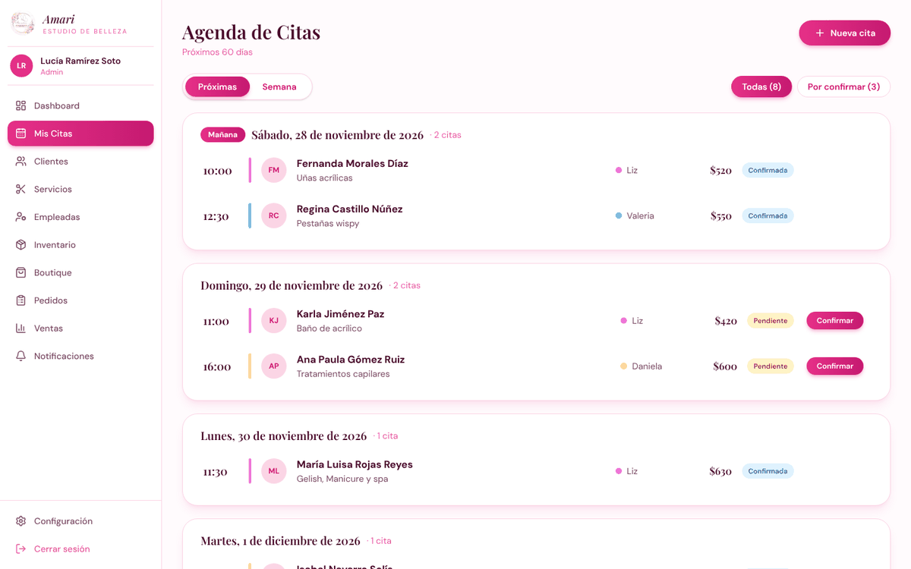
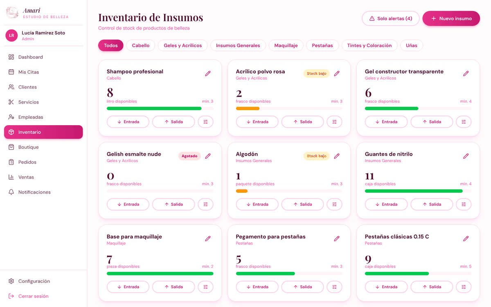
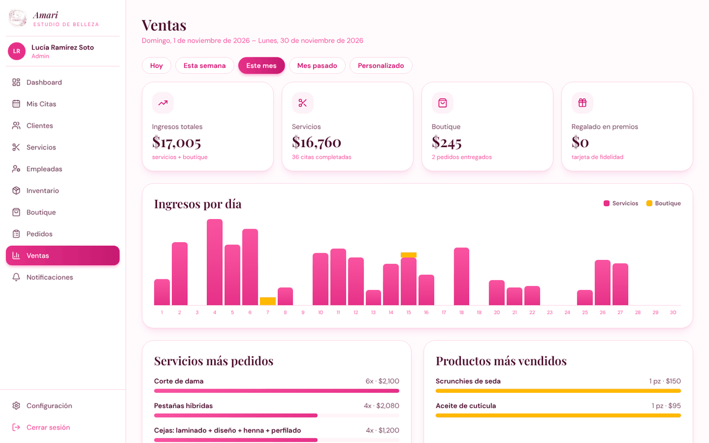
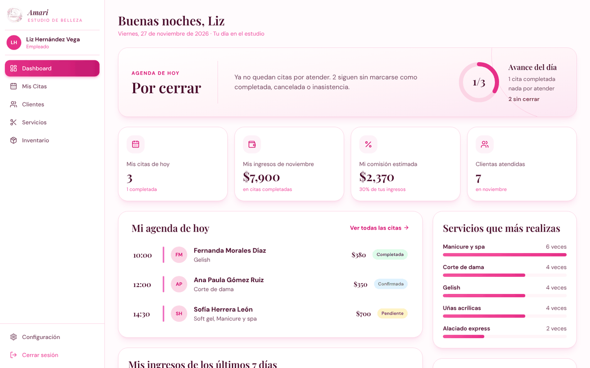
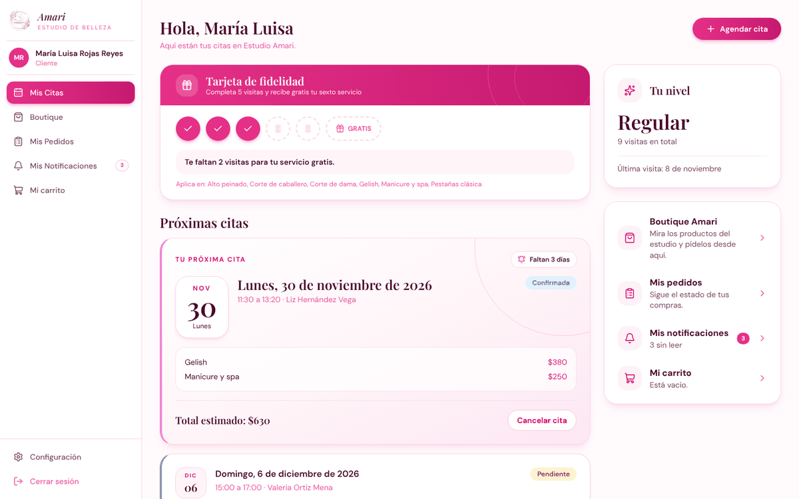
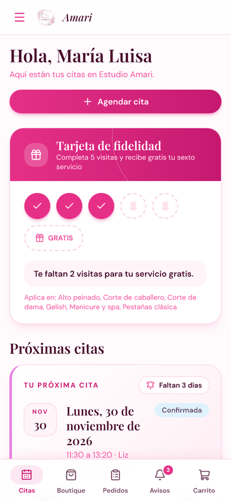
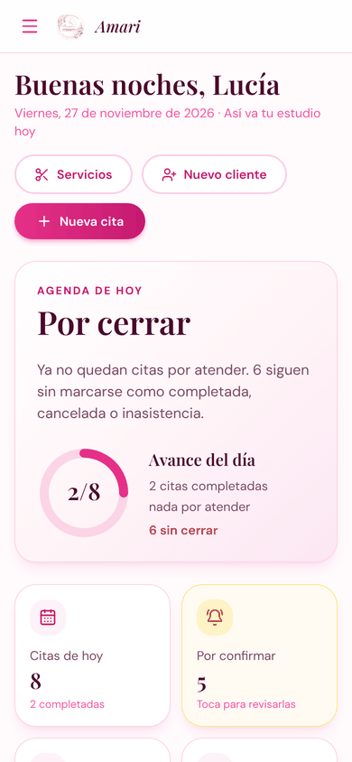
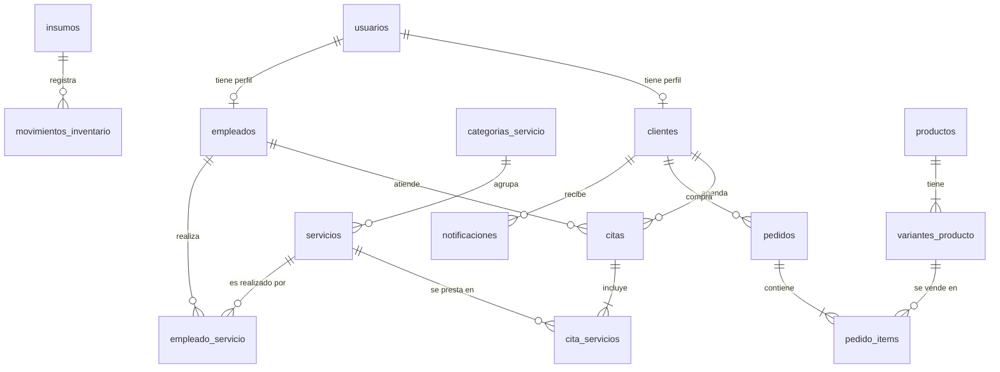

<div align="center">

# Estudio Amari

**Aplicación web para la gestión de un estudio de belleza y boutique**
Agenda de citas · Clientes · Inventario · Boutique en línea · Ventas · Programa de fidelidad

[**Ver demo en vivo**](https://estudio-amari.onrender.com)




</div>

---

## Descripción

Estudio Amari es una aplicación web completa (frontend + API + base de datos) para administrar un estudio de belleza. Tiene **tres roles** con vistas y permisos distintos: **administradora**, **empleada** y **clienta**. Está pensada para usarse tanto en computadora como en celular.

Es un proyecto de portafolio construido para aprender y practicar desarrollo full-stack: autenticación con JWT, control de acceso por rol, reglas de negocio reales, subida de imágenes y despliegue en la nube.

> **Nota:** la demo está en el plan gratuito de Render, que se "duerme" tras un rato sin uso. La **primera carga puede tardar ~50 segundos**; después va con normalidad.

## Cuentas de demostración

Entra a la [demo](https://estudio-amari.onrender.com) con cualquiera de estas cuentas para ver cada rol:

| Rol | Correo | Contraseña |
|---|---|---|
| Administradora | `admin@demo.estudio-amari.com` | `Demo1234!` |
| Empleada | `empleada@demo.estudio-amari.com` | `Demo1234!` |
| Clienta | `clienta@demo.estudio-amari.com` | `Demo1234!` |

Los datos son ficticios y puedes explorar libremente.

## Capturas

### Administradora

<table>
  <tr>
    <td><br><sub><b>Dashboard</b> · agenda del día, ingresos, ocupación y alertas de inventario</sub></td>
    <td><br><sub><b>Agenda</b> · citas por día y por empleada</sub></td>
  </tr>
  <tr>
    <td><br><sub><b>Inventario</b> · insumos, existencias y movimientos</sub></td>
    <td><br><sub><b>Ventas</b> · ingresos por periodo</sub></td>
  </tr>
</table>

### Empleada y clienta

<table>
  <tr>
    <td><br><sub><b>Empleada</b> · su agenda y sus clientas</sub></td>
    <td><br><sub><b>Clienta</b> · sus citas y su tarjeta de fidelidad</sub></td>
  </tr>
</table>

### Versión móvil

<p align="center">
  
  &nbsp;&nbsp;&nbsp;
  
</p>

## Funcionalidades

**Administradora**
- Dashboard con citas del día, ingresos del mes (con proyección), ocupación y servicios más pedidos.
- Agenda de citas con alta, edición, confirmación y cancelación.
- Gestión de clientes, empleados y catálogo de servicios (por categoría, duración y precio).
- Inventario de insumos con movimientos de entrada/salida y alertas de existencias bajas.
- Boutique: productos con variantes (color, presentación…) y fotos.
- Pedidos de la boutique, ventas y notificaciones a clientas.

**Empleada**
- Panel con su agenda del día y sus citas.
- Consulta de clientes, servicios e inventario.

**Clienta**
- Registro e inicio de sesión; recuperación de contraseña.
- Agendar, ver y cancelar sus citas.
- Boutique con carrito y pedidos.
- Notificaciones y **tarjeta de fidelidad**.

**Reglas de negocio**
- **Fidelidad:** a la 6.ª visita, el servicio es gratis (5 visitas acumulan un canje).
- **Cancelaciones:** solo con al menos 12 horas de anticipación.
- **Límite:** máximo 3 citas activas por clienta.
- Zona horaria fija de Ciudad de México en base de datos y servidor.

## Tecnologías

| Capa | Tecnologías |
|---|---|
| **Frontend** | React 19, Vite 8, React Router 7, Tailwind CSS 4, Axios, lucide-react |
| **Backend** | Node.js 22, Express 5, JWT (`jsonwebtoken`), `bcryptjs`, `multer`, `sharp`, `cors`, `dotenv` |
| **Base de datos** | MySQL (compatible) · TiDB Cloud en producción · `mysql2` |
| **Imágenes** | Cloudinary en producción · disco local en desarrollo |
| **Despliegue** | Render (Blueprint `render.yaml`), GitHub |
| **Herramientas** | Git, ESLint, Postman |

## Estructura del proyecto

```text
estudio-amari/
├── render.yaml                  # Blueprint de despliegue en Render
├── README.md
├── docs/
│   └── capturas/                # Imágenes usadas en este README
├── postman/                     # Colección de peticiones de la API
│
├── client/                      # ── FRONTEND (React + Vite) ──
│   ├── index.html
│   ├── vite.config.js           # Proxy /api → http://localhost:3000
│   ├── public/                  # Favicons con el logo del estudio
│   └── src/
│       ├── main.jsx             # Punto de entrada
│       ├── App.jsx              # Definición de rutas
│       ├── index.css            # Tokens de diseño (Tailwind) y clases compartidas
│       ├── assets/branding/     # Logo del estudio
│       ├── layouts/
│       │   └── AppLayout.jsx    # Barra lateral, navegación inferior móvil
│       ├── routes/              # RutaProtegida, redirección según rol
│       ├── context/             # Sesión (AuthContext) y carrito (CarritoContext)
│       ├── hooks/               # useAuth, useCarrito, useAhora
│       ├── services/            # Llamadas a la API (un archivo por módulo)
│       ├── config/              # Constantes y catálogos del dominio
│       ├── utils/               # Fechas, formato, agenda, sesión
│       ├── components/          # Componentes reutilizables y modales
│       └── pages/
│           ├── auth/            # Login, Registro
│           ├── admin/           # Dashboard, Agenda, Clientes, Servicios,
│           │                    # Empleados, Inventario, Boutique, Pedidos,
│           │                    # Ventas, Notificaciones
│           ├── empleado/        # Panel de la empleada
│           ├── cliente/         # Mis citas, Boutique, Carrito, Pedidos,
│           │                    # Notificaciones
│           ├── Configuracion.jsx
│           └── Panel.jsx
│
└── server/                      # ── BACKEND (Node + Express) ──
    ├── .env.example             # Variables de entorno (sin secretos)
    ├── database/
    │   ├── schema.sql           # Esquema completo para desarrollo
    │   ├── seed.sql             # Datos iniciales de desarrollo
    │   ├── produccion.sql       # Estructura final + catálogo (BD nueva en la nube)
    │   └── migracion_01…13.sql  # Historial de cambios del esquema
    ├── scripts/
    │   ├── crear-admin.js       # Crea la cuenta de administradora
    │   └── cargar-demo.js       # Carga datos y cuentas de demostración
    └── src/
        ├── app.js               # Servidor Express; sirve también client/dist
        ├── config/              # Conexión a BD, Cloudinary, subidas, horario
        ├── middlewares/         # Autenticación JWT y permisos por rol
        ├── routes/              # Definición de endpoints por módulo
        ├── controllers/         # Lógica de cada endpoint
        └── utils/               # Contraseñas temporales, URLs de imágenes
```

**Arquitectura en una línea:** `routes` define el endpoint → `middlewares` valida el JWT y el rol → `controllers` aplica la lógica y consulta MySQL. En el cliente, `pages` usa `services` (Axios) y `components` reutilizables.

## Modelo de datos



## Cómo ejecutarlo en local

**Requisitos:** Node.js 22+, MySQL 8 (o MariaDB) y Git.

**1. Clonar el repositorio**

```bash
git clone https://github.com/CortesVizcainoLuisRamon/Estudio_Amari.git
cd Estudio_Amari
```

**2. Crear la base de datos**

```bash
mysql -u root -p -e "CREATE DATABASE estudio_amari CHARACTER SET utf8mb4;"
mysql -u root -p estudio_amari < server/database/produccion.sql
```

**3. Configurar y levantar el servidor**

```bash
cd server
cp .env.example .env        # en Windows: copy .env.example .env
# edita .env con tus datos de MySQL y un JWT_SECRET propio
npm install
npm run dev                 # API en http://localhost:3000
```

**4. Crear la administradora**

```bash
node scripts/crear-admin.js tu@correo.com "TuContraseña" "Nombre" "Apellidos"
```

*(Opcional)* cargar datos y cuentas de demostración:

```bash
node scripts/cargar-demo.js --confirmar
```

**5. Levantar el cliente** (en otra terminal)

```bash
cd client
npm install
npm run dev                 # App en http://localhost:5173
```

El cliente redirige `/api` hacia `http://localhost:3000` mediante el proxy de Vite, así que no necesitas configurar nada más.

## Despliegue

La demo corre 100 % en capas gratuitas:

| Servicio | Para qué | Notas |
|---|---|---|
| **Render** | Web service (API + cliente compilado) | Se define en `render.yaml`; Express sirve `client/dist` |
| **TiDB Cloud Starter** | Base de datos compatible con MySQL | Conexión con TLS (`DB_SSL=true`) |
| **Cloudinary** | Fotos de perfil y de productos | Se activa al definir `CLOUDINARY_URL`; sin ella, se guardan en disco |

Variables de entorno en Render: `DB_HOST`, `DB_PORT`, `DB_USER`, `DB_PASSWORD`, `DB_NAME`, `DB_SSL`, `JWT_SECRET`, `CLOUDINARY_URL`, `TZ`.

Cada `git push` a la rama principal dispara un nuevo despliegue automático.

## Lo que aprendí

- Diseñar una API REST con Express y proteger rutas por rol con JWT.
- Modelar una base de datos relacional con claves foráneas y migraciones.
- Construir un frontend React con rutas protegidas, contexto global y diseño responsive con Tailwind.
- Manejar zonas horarias, reglas de negocio y subida/optimización de imágenes.
- Desplegar una aplicación full-stack en la nube y administrar variables de entorno y secretos.

---

<div align="center">
Desarrollado por <b>Luis Ramón Cortés Vizcaíno</b>
</div>
